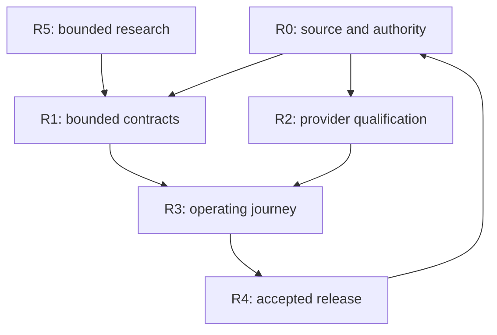

# Capability-based control-plane and sovereign delivery roadmap

**Updated:** 24 October 2026. **State:** current planning candidate; no release acceptance.
The filename is retained for compatibility. Calendar promises are replaced by
capability gates. The [previous calendar roadmap](archive/ROADMAP_12_MONTH_CONTROL_PLANE_PRE_2026_10_24.md)
remains historical context. Existing issues remain implementation authority.

Review: [monthly research alignment](../research/MONTHLY_RESEARCH_REVIEW_2026_10_24.md).
Evidence: [source/claim/issue ledger](../research/MONTHLY_ALIGNMENT_2026_10_24.json).
Portfolio #1390; research #1317; operations #1423; final whitepaper #1422.
The owner has approved the full implementation path; no repeated scope approval
is needed. Required independent review and operation-specific acceptance remain.

## Gate model

R0–R5 retain the existing machine-catalogue meanings. They are overlapping work
streams, not a calendar or a replacement ITIL standard. R5 is research and
experiments, not a synonym for accepted sprint exit.

| Stream | Deliverable | Exit evidence / existing owners |
| --- | --- | --- |
| R0 — evidence and authority | Dated claims, source pins, reconciled issues, applicability and rights | Contradictions resolved or explicitly open; #1317, #1390, org #43, license/provenance owners |
| R1 — contracts and bounded implementation | Compatible runtime/client APIs, page-aware collections, truthful errors, packaging and immutable preflight | Exact-source positive/negative conformance and consumer compatibility; #1349, #1411, #1415, Core #440 and downstream owners |
| R2 — provider/hardware/custody evidence | Fresh operation-bound provider evidence, real device/collateral/replay and independent pilot operators | Actual identity, trust, freshness/revocation/replay, failure and recovery evidence; SDK #240/#241/#559/#583, owner runtime tracks |
| R3 — runtime and commercial integration | Accepted artifact deployed in its isolated lane; actual workflow, recovery and payment-backed entitlement | Source/digest/environment read-back; authenticated journey, committed audit, rollback, real payment reconciliation; #1349, Gateway #466/#507, #1343, Market #159 |
| R4 — release and independent acceptance | Immutable release candidate with accountable owner, required independent review and applicable production acceptance | Actual CI, artifact provenance, operation evidence, soak/rollback and support acceptance; #1336/#937, SDK #202, owning promotion PR |
| R5 — deferred research and experiments | Bounded comparisons for MeshLLM, decentralised providers, BitVM3, M&A and economics | Hypothesis, primary sources, rights, tests and stop criteria; #1317, Gateway #189, #1419, #1491 with their existing sprint-exit prerequisites |

Apply R2 to each workload's actual risk. Public content does not wait for signing
hardware, and a public-distribution test cannot satisfy custody qualification.

## Immediate P0/P1 critical path

1. Retain integrated Business #1493–#1497 and Nexus #450/#453. Do not rebuild or
   regress their packaging, strict client boundaries, transactional audit and
   recovery tooling.
2. Finish remaining runtime evidence producers and page-aware Business consumers.
   Explicitly expose partial lists rather than treating a default page as a full
   audit history. Keep authenticated unavailable outcomes until real evidence exists.
3. Propagate the reviewed Core operation contract through Gateway/Nexus and
   Platform/Wallet. Bind exact chain/network/operation, provider, artifact,
   freshness and independent acceptance; do not copy registry counts.
4. Qualify one actual provider/hardware profile in parallel with non-value public
   artifact operations. Preserve independent custody and durable replay ownership.
5. Deploy the accepted candidate through the existing normal promotion chain.
   Demonstrate authenticated state writes, read-back, source-loss/application
   recovery and rollback on the intended environment.
6. Prove real billing, entitlements, key lifecycle and actual costs before
   broad commercial activation. Keep managed charges, signature quotas,
   settlement fees and entitlement separate.
7. Admit production migration only with actual owner acceptance, customer/revenue
   continuity and tested exit. Finalise the whitepaper/economics only after the
   accepted sprint exit; candidate corrections and research may proceed now.

## Decentralised rollout by workload

| Workload | First usable increment | Promote when |
| --- | --- | --- |
| Public documentation/site | Existing allowlist and source-pinned offline CAR intake | Separate administrators serve the accepted CID, retrieval and rollback pass, and retention is funded/owned |
| Stateless worker/API | Same qualified OCI artifact on a bounded Akash or operator trial | Replacement provider, auth/secrets, operation contract, recovery and measured cost pass |
| Derived state and backups | PostgreSQL schema/export and encrypted secondary object trial | Actual restore, single-writer/replay behavior, key recovery and permitted retention/deletion pass |
| Inference | Model/code-pinned local or admitted MeshLLM comparison | Admission, prompt rights/confidentiality, resource/payment limits, cancellation and recovery are accepted |
| Signing | Existing provider/hardware and threshold qualification track | Real attestation/collateral, authorization, independent operators, durable replay, recovery and security review pass |
| M&A public observations | Source/provenance and validation foundation after #1491 entry gates | Licensed real sources, transparent calculation lineage and human decision boundaries pass |
| Engineering continuity | Additional export/mirror and recovery trial | Repo/issue/release history and authority can be recovered without competing work records |

## ITIL 5 operating mapping

The official model has eight activities. The following is Conxian's working map,
not a claim of certification or operating effectiveness:

| ITIL activity | Apply across the workstreams |
| --- | --- |
| Discover | R0 demand, risks, customer evidence and R5 hypotheses |
| Design | R1 contracts, trust boundaries, failure semantics and acceptance design |
| Acquire | R2 provider/hardware/data rights, operator resources and costs |
| Build | R1 implementation and meaningful conformance |
| Transition | R3 migrations/deployment and R4 release/rollback acceptance |
| Operate | R3 observed health, state recovery and operational evidence |
| Deliver | R3 actual customer journeys, support commitments and payment-backed entitlement |
| Support | Incident/problem ownership, remediation, knowledge retention and R0 feedback |

Reference: [official ITIL 5 overview](https://www.itil.com/Itil-News-and-Announcements/itil-version-5-foundation-whats-new-guide),
checked 24 October 2026.

## Progress, stop and revision rules

Report implemented, tested, deployed and independently accepted separately.
Known missing access/evidence stays unknown, not healthy. Retain exact artifacts,
limits and failure observations. A same-runner fixture recovery cannot establish
independent operators or production RPO/RTO.

Continue research where it resolves a concrete issue; stop or revise a candidate
that fails rights, confidentiality, consistency, recovery, sustainable costs or
support requirements. Do not create infrastructure merely because a repo exists.
Do not shut down managed services until replacement and customer continuity pass.

GitHub issues/PRs are the authoritative work records. Preserve existing milestone
metadata; Projects are optional views and their current content is unverified by
this connector. Use the monthly issue matrix until actual board access is available.
